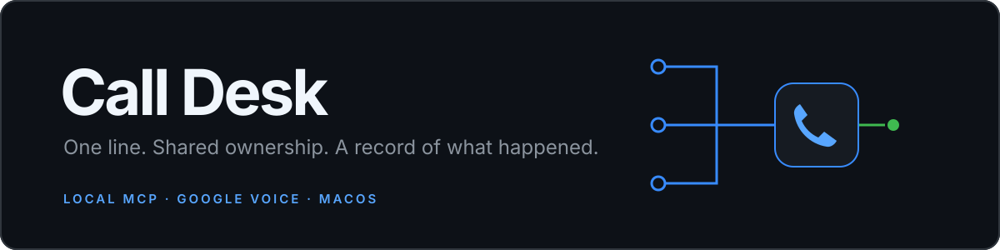
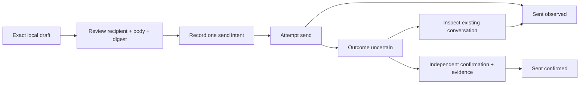
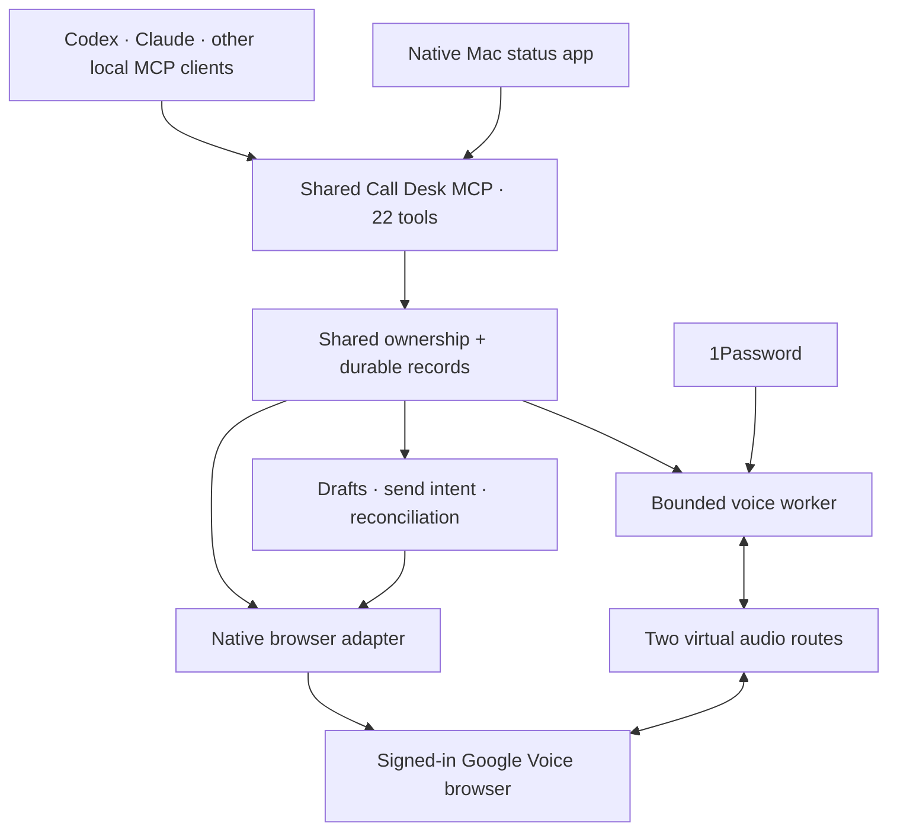

<p align="center">
  
</p>

<p align="center">
  <strong>One phone line. A shared desk for your agents.</strong><br />
  Google Voice calls and texts, coordinated through a local MCP service and a native Mac app.
</p>

<p align="center">
  
  
  
  
  
</p>

<p align="center">
  <a href="#what-it-does">Features</a> ·
  <a href="#how-it-fits-together">Architecture</a> ·
  <a href="#get-started">Setup</a> ·
  <a href="#the-mcp-interface">Tools</a> ·
  <a href="#what-is-proven-and-what-is-next">Status & roadmap</a>
</p>

---

> **Unofficial project — not a Google-supported solution.** Call Desk is independent and is not affiliated with, endorsed by, or supported by Google. It automates the Google Voice web interface; it is not an official Google Voice API integration.

### Point Claude or Codex here

Tell your local agent:

> Install https://github.com/joewilsonai/shared-call-desk. Follow its README and agent installation guide, preserve my existing setup, and tell me exactly what is working and what still needs attention.

**Agent entry point:** when the user has asked you to install this project, start with [the installation guide](docs/AGENT-INSTALL.md), then read [the workflow skill](plugin/skills/shared-call-desk/SKILL.md). The guide covers dependency checks, local configuration, MCP registration, applicable client skill setup, and verification. Follow the user's task authorization; a repository URL alone is not permission to send messages, make calls, or change phone routing.

Your agents can write a message or prepare a phone call. The harder part is sharing the same line: knowing who owns the browser, what was actually sent, whether a call ended, and what to do when a tool times out.

**Call Desk gives that work a shared record.** Compatible local agents use the same MCP service, browser reservation, immutable drafts, call records, and recovery rules. A native macOS app makes the connection and cleanup state visible.

> **Current release:** service/plugin **0.3.2**, Mac app **0.1.6**. Outgoing voice and SMS have been exercised locally. Incoming answering is experimental. The native browser adapter can still need a visible, foreground window; background operation is the next major step.

## What it does

| Capability | Behavior |
| --- | --- |
| **Text from your agents** | Read observed conversations, prepare an exact draft, and send the reviewed recipient/body pair. |
| **Share one line** | Calls and live messaging use a durable shared reservation across local agent processes. |
| **Keep retries deliberate** | Record send/dial intent before dispatch. An uncertain attempt is retained for inspection rather than automatically repeated. |
| **Recover with evidence** | Reconcile an attempted text using independently confirmed delivery or an authenticated conversation observation, with an audit record. |
| **Run bounded voice sessions** | Pass a focused call brief to an ElevenLabs voice worker through local virtual audio devices. |
| **See the desk’s state** | A SwiftUI/AppKit menu-bar app shows service, browser, audio, call, messaging, and cleanup status. |
| **Test incoming reception** | Explicitly arm one bounded call window for an allowed caller. It is never armed just because the app started. |

### A message has a lifecycle



`sent_observed` means the interface supplied the expected evidence. `sent_confirmed` records independent **operator-reported evidence**, such as the recipient confirming arrival. Neither is a read receipt. Browser cleanup is tracked separately, so a successful send cannot silently erase an unresolved browser operation.

## How it fits together



Everything runs on the same Mac. The operating agent handles outgoing browser dialing; the service owns the audio worker and call record. The native adapter handles live texts and the experimental incoming-call path.

The voice worker receives the call brief and selected context. It does not automatically inherit the operating agent’s entire chat, memory, or computer tools.

## Have your agent install it

The short prompt above works for Claude Code or Codex. For a more detailed handoff, paste:

> Install Shared Call Desk from https://github.com/joewilsonai/shared-call-desk on this Mac. Read the README, `docs/AGENT-INSTALL.md`, and the shared-call-desk skill. Inspect existing installations first, preserve my runtime state and other MCP servers, set up dependencies and local config, register the MCP server in my intended client, install its applicable skill, and run the offline checks. Build the optional Mac app if its requirements are available. Verify actual client tool discovery and report any exact browser, credential, audio or permission step still needed. Use my existing task authorizations; ask only for genuinely missing information or an independently required confirmation. Do not send a test text or place a call as part of installation unless I have explicitly authorized that test.

The [agent installation guide](docs/AGENT-INSTALL.md) contains the commands, configuration fields, verification steps and recovery boundaries. It explicitly identifies the external native dependency and distinguishes a configured MCP server from a live, connected phone desk.

## Get started

### Before you install

You need:

- **macOS 14+**. The native app build currently targets Apple Silicon.
- **Python** and the pinned dependencies in `requirements.lock`.
- **Google Chrome**, signed in to the Google Voice account you intend to use.
- **Patched `agent-desktop`**, installed from [our pinned Call Desk source fork](third_party/agent-desktop/README.md) with the macOS window/identity fixes. The agent install guide now includes the complete source-build/install recipe; Rust and Xcode command-line tools are required.
- For voice: **ElevenLabs**, the **1Password CLI**, and two virtual audio routes using Loopback or an equivalent local setup.
- For the Mac app: Xcode command-line tools and your own existing code-signing identity.

### 1. Install the Python runtime

```sh
git clone https://github.com/joewilsonai/shared-call-desk.git
cd shared-call-desk
python3 -m venv .venv
.venv/bin/python -m pip install -r requirements.lock
cp config.example.json config.json
```

Edit the local `config.json`: set the absolute path to `voice_bridge.py`, your ElevenLabs agent ID, and your 1Password secret reference. The repository includes an example configuration; actual credentials belong in your local credential system.

### 2. Connect the browser and audio

Install or verify the [patched native-control dependency](third_party/agent-desktop/README.md) first, then build the Call Desk exact-window helper:

```sh
zsh build_native_focus.sh
```

Enroll the **actual** Google Voice window, process generation, account, Voice number, and observed controls in private `state/google-voice-ui.json`. This is an operator setup step; enrollment is not yet a guided installer. New incoming-call controls must be observed before enabling their verification flag.

For the example voice routes:

| Google Voice setting | Device |
| --- | --- |
| Microphone | `Elle Call Mic (Virtual)` |
| Speakers | `Google Voice Return (Virtual)` |

The worker listens to Google Voice Return and speaks into Elle Call Mic. Verify both audio directions. The example config uses `restore_original`; choose `keep_virtual` deliberately if the virtual devices should remain selected after cleanup. Existing call records retain their saved policy.

### 3. Connect an agent

Add the server to a compatible local MCP client, replacing the path with your checkout:

```json
{
  "mcpServers": {
    "shared-call-desk": {
      "command": "/absolute/path/to/shared-call-desk/.venv/bin/python",
      "args": ["/absolute/path/to/shared-call-desk/server.py"]
    }
  }
}
```

Client examples: [Claude](client-configs/claude.json) · [Codex](client-configs/codex.toml) · [Hermes](client-configs/hermes.yaml).

For Claude Code, install the [agent skill](plugin/skills/shared-call-desk/SKILL.md):

```sh
mkdir -p ~/.claude/skills
ln -s "$PWD/plugin/skills/shared-call-desk" ~/.claude/skills/shared-call-desk
```

Claude Desktop uses the MCP server instructions. Reconnect an existing client after changing the server’s tools. All clients must use the same runtime/state directory to share ownership correctly.

### 4. Build the optional Mac app

```sh
CALL_DESK_SIGNING_IDENTITY="YOUR_SIGNING_IDENTITY" zsh mac-app/build.sh
.venv/bin/python install_mac_app.py --source "mac-app/build/Call Desk.zip"
```

The app looks for the runtime at `~/CodingProjects/shared-call-desk`. Set `CALL_DESK_SERVICE_ROOT` in its launch environment for another location. Starting the app, including at login, does not arm answering. Registration alone does not establish working macOS permissions or restart recovery.

## The MCP interface

The running server’s schemas are the source of truth. Version 0.3.2 exposes **22 tools**:

| Group | Tools |
| --- | --- |
| **Calls · 12** | `call_preflight`, `call_prepare`, `call_start`, `call_status`, `call_dial_intent`, `call_observe`, `call_stop`, `call_finish`, `call_recover`, `call_takeover`, `call_reconcile`, `call_report` |
| **Incoming · 3** | `incoming_arm`, `incoming_status`, `incoming_disarm` |
| **Texts · 7** | `text_inbox`, `text_read`, `text_draft`, `text_send`, `text_status`, `text_recover_browser`, `text_confirm_sent` |

### Useful details

- **Exact drafts.** Recipient, body, and optional reply binding are retained under a digest. An edited message needs a new review.
- **Idempotent requests.** Reusing a request key resumes the same operation; conflicting content is rejected.
- **Specific errors.** A blocked number returns its actual error code and blocking draft ID, rather than a generic tool failure.
- **Evidence-bound recovery.** `text_confirm_sent` requires the original owner/digest, an existing send intent, and independent evidence. It cannot turn an unsent draft into a sent message.
- **Bounded incoming calls.** Arming requires an explicit caller allowlist and time/call limits. Caller ID is a routing hint, not authentication.
- **Local trust model.** Owner labels coordinate agents sharing one OS account; they are not an authentication boundary between hostile users.

Read the [workflow skill](plugin/skills/shared-call-desk/SKILL.md) and [tool/evidence contract](plugin/skills/shared-call-desk/references/contract.md) before operating the desk.

## Validation

**490 Python tests passed locally** for the source exported into this repository. A separate real stdio MCP smoke check exercises local drafts, structured blocking errors, and audited confirmation in isolated synthetic state. Native helper and app builds run their own offline fixtures.

```sh
.venv/bin/python -m pytest -q --disable-warnings
.venv/bin/python verify_mcp.py
```

The smoke check places **no real calls or texts**. The badge above reflects a local test result; it is not a hosted CI status or proof of unattended operation.

## What is proven, and what is next

| Area | Current evidence |
| --- | --- |
| Outgoing audio | A real two-way bridge test completed. |
| Text sending | Real messages reached their recipients; one recipient confirmed arrival and another replied. Private messages are not included here. |
| Recovery logic | Offline tests and the isolated MCP check cover shared ownership, uncertain dispatch, evidence records, and explicit cleanup. |
| Incoming answering | Experimental. A completed end-to-end automatic incoming call remains unverified. |
| Native browser control | Requires the enrolled window/process/account. Foreground access and macOS Spaces can interrupt automation. |
| Automatic receipts | The send call now runs bounded receipt verification automatically, including the same recipient-bound reopen used by status refresh. Delayed confirmation and recovery are tested offline; a fresh live send still needs to validate this change. Independent confirmation remains explicitly labeled. |
| Restart recovery | Browser identity, sign-in, permissions, and provider authorization can need reconnection. |

### Next: stop borrowing your desktop

The next major step is a **dedicated background browser** controlled directly by the service. The planned sequence is inbox reads, one authorized send plus reply, then voice/audio and restart recovery. Background operation has not been implemented in this release.

Read the [V2 implementation plan](docs/V2-PLAN.md) for milestones, architecture, acceptance gates, and the restricted call-lane design. The earlier [background-browser note](BACKGROUND-BROWSER-PLAN.md) records the initial proposal.

## Repository map

```text
server.py                         MCP entry point
service.py                        Call ownership, lifecycle and reservations
messaging.py                      Drafts, dispatch, receipts and confirmation
browser_operation.py              Shared call/message browser ownership
google_voice_*.py                  Native Voice adapters and parsers
worker.py · voice_bridge.py        ElevenLabs session and audio transport
incoming*.py                      Bounded incoming-call control
native_focus.m                    Exact-window helper
mac-app/                          SwiftUI/AppKit app
plugin/ · marketplace/            Agent instructions and plugin definitions
third_party/agent-desktop/        Pinned patch, license and dependency installer guide
fixtures/ · test-fixtures/        Sanitized and synthetic fixtures
test_*.py · verify_mcp.py          Offline tests and isolated protocol check
```

## Private runtime, public source

This repository includes source, tests, sanitized fixtures, example configuration, and plugin definitions. It excludes local configuration, credentials, browser profiles, message history, recordings, native binaries, installation backups, and account-specific verification records.

The currently running installation is maintained separately from this source checkout until explicitly migrated.
