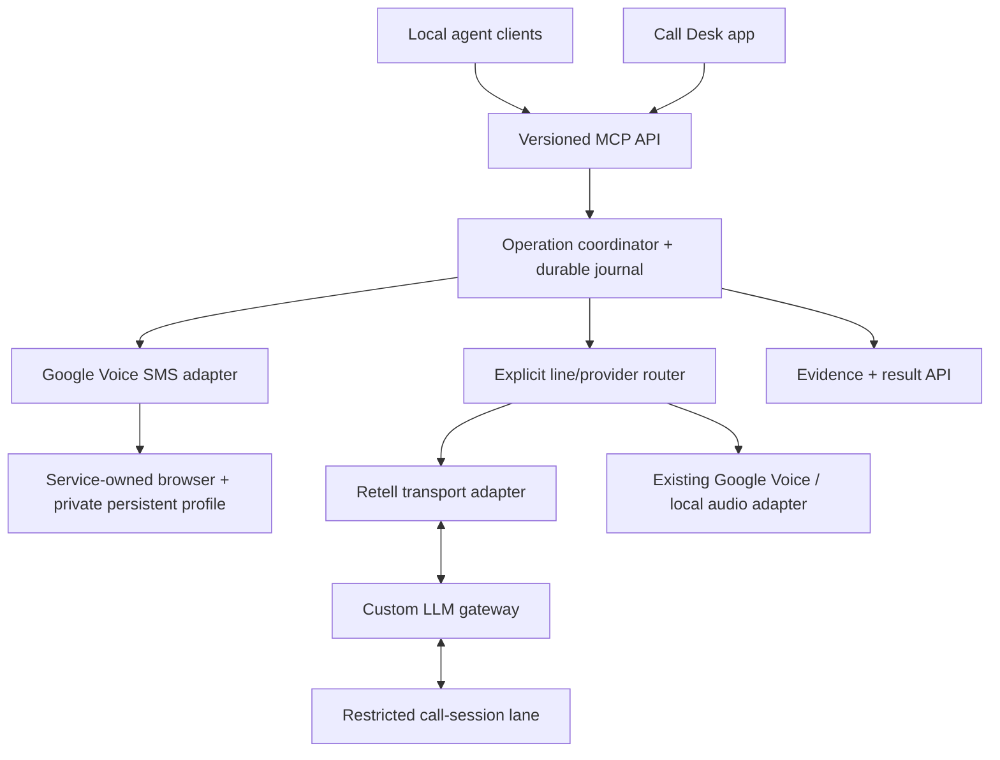

# Call Desk V2 — a background service your agents can share

**Status:** proposed implementation plan. V2 is not shipped. The current service remains 0.3.2; the Mac app remains 0.1.6.

## Outcome

Send a message, receive a reply, and coordinate a call while the user keeps working in another app. The desk owns its browser and recovery process. Agents get a specific result, a useful error, or a clearly labeled uncertainty without taking over the desktop.

The first release gate is a background SMS round trip. Voice integration follows after that foundation works.

## What V1 taught us

1. A send can succeed before the page exposes its receipt. Check after sending, then reconcile the same conversation. Never solve that delay by clicking Send again.
2. Editable recipient chips and normal conversation headers are different views of the same thread. Parse identity in both.
3. A browser click receipt is weaker evidence than an observed message. An observed outgoing message is weaker evidence than recipient-confirmed delivery.
4. A completed message and a released browser are separate outcomes.
5. macOS focus, Spaces, AX references and account enrollment make native automation fragile during concurrent work.
6. Every agent needs the same tool contract, discoverable instructions, ownership record and specific errors.

## Proposed architecture

The Retell deployment brief describes an existing custom-LLM server reached through a tunnel, with calls routed into a restricted session lane. That deployment has not been inspected as part of this repository. Preserve its boundary: Retell provides the call/voice transport; the application-controlled session produces the words and mediates tools. It must not automatically inherit an unrestricted assistant session.

V1's shipped ElevenLabs worker is a separate path. V2 must select an explicit line, provider agent and session lane. It must not assume that a Retell-managed line and a Google Voice number are interchangeable, or that another agent on the same provider account is the intended one. No number migration or forwarding change is part of this plan.

## Build sequence

| Stage | Deliverable | Acceptance gate |
| --- | --- | --- |
| 0 — stabilize V1 | Automatic bounded receipt checks inside `text_send`, using the same recipient-bound check as refresh | Delayed-message, reopen-only, transient-navigation, wrong-account, timeout and no-duplicate tests pass. Fresh live validation still required. |
| 1 — background SMS proof | Browser lifecycle owner and read-only inbox adapter using a dedicated persistent profile | Correct source account/number observed while another app stays foreground. No native click or global keyboard path used. |
| 2 — complete SMS lifecycle | Exact drafts, one dispatch, bounded verification, incoming reply reads and explicit uncertainty | An authorized send and reply succeed without focus changes. Crash-after-click does not cause a duplicate. Wrong account and changed recipients reject. |
| 3 — voice and session routing | Provider adapter contract, explicit line/agent binding and restricted call-lane gateway | Verify the selected provider agent, custom-LLM route, interruption handling and both audio directions in a bounded authorized test. |
| 4 — service and app lifecycle | Login startup, health checks, reconnect controls and inspectable journal | Browser restart preserves pending work. Expired login asks for attention. App status distinguishes configured, connected, observed and verified. |
| 5 — packaging | Guided enrollment, discoverable skills and reproducible installation | A clean supported Mac can reach a verified inbox without undocumented local tools. Clients reconnect and discover the same schema. |

### First implementation slice

Create a browser-owner module and a read-only Google Voice adapter behind an interface. Keep V1's native adapter available for rollback.

1. Launch one browser with an explicitly selected private profile. Never reuse or kill the user's everyday Chrome processes.
2. Navigate through visible page controls; verify account and source number before exposing messages.
3. Read the inbox and one explicitly selected conversation while another app remains foreground.
4. Save sanitized fixtures for loading, expired login, changed account, empty history, numeric and named recipients, and a normal post-send thread.
5. Expose adapter health to the existing app without changing the live sending adapter yet.

Only after that read-only slice passes should the background adapter gain the authorized send operation.

## Browser choice and validation

Playwright supports persistent browser contexts and headless operation. That capability makes it a candidate, not proof that Google Voice login, calls, microphone access or audio playback will work in the chosen mode. Test a service-owned background headed browser and headless Chromium separately. Choose the mode from observed SMS and audio results. [Playwright browser-context documentation](https://playwright.dev/python/docs/api/class-browsertype)

Prefer a local browser-control pipe. Any diagnostic endpoint must remain local and private. Authentication challenges may require opening a visible sign-in window; they are not an excuse to weaken account checks. The service must survive a browser restart by verifying the new browser instance and restoring only its own durable operations.

## Voice contract

Retell documents a custom LLM integration using an application-operated WebSocket server. Its demo is a useful protocol reference; it does not establish the configuration of any existing account. [Retell custom LLM integration](https://www.retellai.com/integrations/custom-llm), [official Python example](https://github.com/RetellAI/retell-custom-llm-python-demo)

Before connecting a live line, verify:

- The exact provider agent ID, line identity and custom-LLM endpoint are the intended ones.
- The session router creates or resumes the correct restricted call lane.
- Only selected task context is supplied; no whole-chat or whole-memory transfer by default.
- Tools have explicit delegated authority, bounded duration and clear external-effect receipts.
- Barge-in, disconnect, retry, timeout and reconnect behavior are tested without repeating external actions.
- Tunnel ingress authentication and event verification follow the chosen provider integration. The tunnel itself is not application authentication.

Exact tunnel endpoints, account identifiers, credentials and deployment-specific routing belong in private configuration, not this public plan.

## Operations and evidence

Each operation should expose separate fields for dispatch, observation, delivery evidence and cleanup. Keep the existing immutable draft digest and idempotency key. Add a stable operation ID, adapter version, verification attempts and a structured blocker/recovery action.

A daemon restart must inspect existing intent before doing anything. Confirmed sends remain terminal. Unknown sends remain unknown until evidence resolves them. A retry of a read is distinct from a repeat of a send. Cleanup failure must not erase successful message evidence or falsely claim the browser is free.

Owner labels remain coordination metadata on a shared local OS account. Cross-machine access, if later requested, needs a separate authenticated interface and authorization model.

## App experience

- Show service, browser, source account, SMS, voice provider and session lane health separately.
- Keep normal operation out of the foreground.
- Show **Needs sign-in**, **Verifying send**, **Sent observed**, **Delivery confirmed**, **Outcome uncertain** and **Cleanup required** distinctly.
- Provide one deliberate recovery action with the actual blocking operation and reason.
- Avoid claiming always-on availability merely because the menu-bar icon exists. A local Mac still needs to be awake; independent uptime would require an always-on host.

## Test matrix

| Scenario | Required behavior |
| --- | --- |
| Another app stays foreground | Background inbox/read/send does not move focus. |
| Receipt arrives late | Same send call verifies it when it appears within bounds. |
| Crash after send click | Restart inspects the original operation; no automatic resend. |
| Old identical message | No false confirmation based on text alone. |
| Empty or virtualized history | Keep uncertainty unless stronger evidence resolves it. |
| Wrong account or source number | Reject before dispatch. |
| Recipient changes after review | Reject the send; preserve the reviewed draft. |
| Two agents request work | One browser owner; explicit queued/busy response for the other. |
| Incoming SMS contains instructions | Treat it as content, not delegated authority. |
| Provider/tunnel disconnects | Preserve the call/session outcome and report the exact failure. |
| Login expires or Mac sleeps | Show the actual unavailable state; recover deliberately. |

Live tests must use explicitly authorized recipients and content. No test plan is standing authorization to send messages, dial calls, change provider agents, or change a number's routing.

## Decisions to resolve during the first slice

- Background headed Chrome versus headless Chromium: choose from observed behavior.
- Replace the native dependency completely, or retain it only for operator-assisted enrollment and recovery.
- How Google Voice and separately configured Retell lines should appear in the line selector.
- Whether deployment should remain on the user's Mac or later move to an always-on host.
- Whether bounded one-operation handling should remain a busy response or become an explicit persisted queue.

These decisions do not block the read-only background inbox proof. No provider migration or full-session delegation is assumed.
